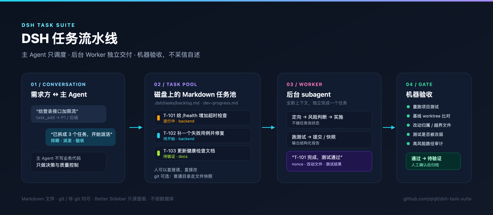
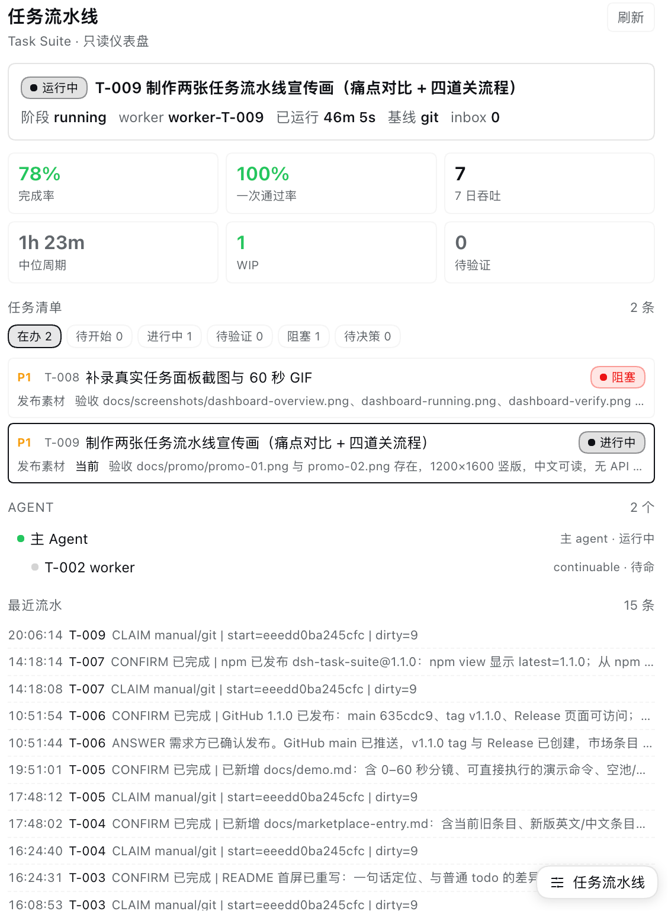

# DSH Task Pipeline

[**English**](README.md) · [简体中文](README.zh-CN.md)

**Turn one DSH agent into an engineering team.**

> The lead agent only schedules. Background agents deliver. Nothing counts as done until a machine re-runs the tests.

[](https://www.npmjs.com/package/dsh-task-suite)
[](LICENSE)
[](https://github.com/qiqll/dsh-task-suite)
[](https://awesome-dsh-plugin.com)

[**Landing page**](https://qiqll.github.io/dsh-task-suite/) · [npm](https://www.npmjs.com/package/dsh-task-suite) · [Plugin market](https://awesome-dsh-plugin.com) · [Release 1.2.0](https://github.com/qiqll/dsh-task-suite/releases/tag/v1.2.0)

A port of Claude's `task-*` workflow to DeepSeek Harness: a Markdown task pool, a state machine, a lead session that schedules instead of coding, background workers with fresh context, machine acceptance, and a read-only live dashboard.

It is not another todo list. It solves the problem that "the AI said it is done, but nobody verified it".

**git is optional**: in a git repo, acceptance uses commits and `git worktree`; in a plain directory it automatically falls back to file snapshots, using a snapshot plus a file manifest for baseline comparison, change attribution, test-weakening audit, and rollback.

## Your agent today behaves like an assistant on call

- **Synchronous**: it does one thing, you watch one thing; the next request waits until it is idle.
- **Self-reported**: whether tests ran, whether the diff stayed in scope, whether tests were weakened — all you have is its word.
- **Black box**: what it is doing, what is stuck, how much is left — you dig through the chat log.

The bottleneck is not model capability. It is the working model: assistant mode. What is scarce is **management**, not intelligence.

## Four swaps, one hard line

| # | From | To | What it means |
|---|---|---|---|
| 01 | Assistant | **Team** | The lead agent acts as tech lead: conversation, breakdown, scheduling, acceptance. The actual work goes to subagents with independent context. |
| 02 | Conversation | **Task** | Every request gets an ID, priority, acceptance criteria, status, and dependencies. Work is delivered like engineering, not like chat history. |
| 03 | Synchronous | **Asynchronous** | You can file several requests at once; the pool drains in order. You no longer wait for one task before describing the next. |
| 04 | Black box | **Cockpit** | Tasks, agents, metrics, and the event stream on one screen: what is running, what is stuck, what needs your confirmation. |
| — | Self-report | **Evidence** | **The hard line**: "done" from a worker is not done. A machine re-runs the tests, compares against the baseline, audits test weakening, and a human confirms last. |

> "Asynchronous" describes filing and interaction: you can queue requests without waiting. Execution itself stays serial by default — one active task at a time — so two workers never corrupt the same working tree.

## How it differs from generic multi-agent setups

| Dimension | Generic multi-agent / todo list | DSH Task Pipeline |
|---|---|---|
| Unit of work | A conversation, a prompt | A task with ID, acceptance criteria, and status |
| Who does the work | The lead agent itself, or ad-hoc delegation | A worker with fresh context; the lead only schedules |
| Definition of done | The worker says so | Machine re-run + baseline diff + human confirmation |
| Interaction | Synchronous, one at a time | Requests enter a pool and drain as a pipeline |
| Visibility | Scroll the chat log | Tasks / agents / metrics / event stream |
| Storage | git, a database, or a SaaS | Markdown on disk; git optional |

**Multi-agent is a means, not a product.** Without a task contract, an acceptance gate, and visibility, multi-agent just parallelizes chaos.

## 60-second quickstart

```text
task_init
task_add items=[{title: "Rate-limit the login endpoint", module: "backend", priority: "P1", acceptance: "pytest tests/test_auth.py passes"}]
task_loop action=start max=3 hours=2
task_loop action=tick        # hand the returned worker_prompt to a subagent
# after the subagent reports: task_accept report="<report block>" → task_confirm
```

Then open **Task Pipeline** from the right-sidebar `+` menu or the floating button, and watch a task move from `pending` to `awaiting verification`.



> The diagram above is illustrative. Below is the panel captured from a real session:



> The panel includes the task pool, agents, metrics, and the event stream; the screenshot is from a real T-009 run with local paths cropped. The pending-verification state (acceptance criteria, how to verify, default-pass date) is captured in [`dashboard-verify.png`](docs/screenshots/dashboard-verify.png).

> Posters: [self-report vs machine acceptance](docs/promo/promo-01.png) · [one task, four gates](docs/promo/promo-02.png)

## Install

From npm (recommended):

```sh
dsh plugin --profile desktop add dsh-task-suite
# use --profile web for the Web profile
```

Or straight from GitHub:

```sh
dsh plugin --profile desktop add qiqll/dsh-task-suite
```

> `--profile` is required: `desktop` for the desktop app, `web` for the Web build. Use whatever profile name you actually run.

You can also install from **Settings → Plugins** by searching for `dsh-task-suite`. Tools and the three skills (`task-admin` / `task-loop` / `task-worker`) register automatically.

**After the first install you must fully quit and reopen DSH.** The Web client plugin graph is composed at process start; a page refresh does not load the client half of a new plugin. Host tools and the task pool are unaffected. After that, any session works.

For local development, `link:` this directory into the profile's dependencies; disabling/enabling the plugin row hot-reloads the Host side, while client UI changes still need one full restart.

## Web dashboard

**Task Pipeline** is a read-only dashboard that gathers the task pool, the current worker, the gates, and runtime metrics in the right sidebar.

Two ways to open it (from any session):

- the floating **Task Pipeline** button at the bottom right (the most direct one);
- the **+** menu at the top of the right sidebar → **Task Pipeline**.

It refreshes every 5 seconds and shows:

- **Loop state**: running / stopped / halted / idle;
- **Current task**: `T-xxx`, phase, worker, uptime, snapshot/baseline, gate notes, inbox count;
- **Metrics**: completion rate, first-pass rate, 7-day throughput, median cycle time (CLAIM → CONFIRM), WIP, awaiting verification;
- **Task list**: filter by status; expand for notes, dependencies, acceptance criteria;
- **Agents**: activity of the lead agent and the current subagent;
- **Recent activity**: claim / done / confirm / reject / stop from the run log.

The UI depends on [dsh-better-sidebar](https://github.com/omdsh-dev/DSH-better-sidebar), but only as a **soft dependency**: without it, tools, the API, and the task pool all work — you just lose the panel, and the Web app still boots.

Data comes from a read-only endpoint the plugin registers: `GET /dsh-task-suite/state?sessionId=…&cwd=…`. It never mutates the pool.

## Plugin market

| Directory | Where | Notes |
|---|---|---|
| [awesome-dsh-plugin](https://awesome-dsh-plugin.com) | category `workflow` | cards, installs, and updates are driven by that directory and npm versions |
| [DSH Go](https://go.dshtui.com/p/dsh-task-suite) | `plugins/dsh-task-suite.json`, merged 2026-11-27 | entry pinned to the exact npm version; index rebuilt from the market repo |

The App Store–style screenshots on the detail page come from [`screenshots.json`](screenshots.json) at the repo root: four images (panel overview, running, pending verification, pipeline diagram) stored in [`docs/screenshots/`](docs/screenshots/). Changing a screenshot only needs an edit to that JSON — no new release.

## Quick start

```text
task_init                                   # creates .dsh/tasks/ (and adds it to .gitignore in a git repo)
task_add items=[{title, module, priority, deps, acceptance, note}]
task_status                                 # global view / decisions / blockers / activity
task_pick mode=manual task_id=T-001         # single step: pick and implement yourself
task_accept report="<report block>"         # machine acceptance
task_confirm task_id=T-001 conclusion="..." # archive after the requester confirms
```

Automatic loop (recommended):

```text
task_loop action=start max=10 hours=8
task_loop action=tick        # returns worker_prompt
# hand worker_prompt to the subagent tool as-is; then end the turn and wait for the completion notice
# after the worker's last message:
task_accept report="<the whole report block>"
# pass → awaiting verification; requester confirms → task_confirm; otherwise → task_reject
task_loop action=tick        # dispatch the next one
```

Stopping: `task_loop action=stop reason="..."`. Interrupting mid-flight: `interrupt_agent` first, then
`task_loop action=halt` (keeps commits, no rollback). Continue with `action=resume`
(re-dispatch the same task from its checkpoint) or `action=requeue` to put it back.

## State and layout

```text
.dsh/tasks/
├── backlog.md          # requester entry point: P0–P3 tables, decisions, manual blockers, ID rules
├── dev-plan.md         # maintained by the agent: current batch, in progress, prerequisites
├── dev-progress.md     # archive of completed work (by month)
├── inbox/              # deliveries from the requester/scheduler (task_*.json), moved to .merged/ after merge
└── auto/               # runtime state, gitignored as a whole
    ├── current.json    # current task: nonce / startSha / dirty files / phase
    ├── session.json    # loop session: active / max / hours / done / noprog
    ├── run.log         # activity log
    ├── STOP            # stop marker
    └── snapshots/      # non-git mode: start snapshot + manifest (deleted after confirm)
        └── T-001-<nonce>/
            ├── manifest.json
            └── files/
```

In a git repo, `task_init` adds `.dsh/tasks/` to `.gitignore`; in a non-git directory it creates no `.gitignore`. The pool is runtime state and never enters business commits.
Each working directory has its own pool; Claude's `.claude/` pool is left untouched.

State machine:

```text
pending → in progress → awaiting verification → done
             └→ blocked / needs decision → pending
             └→ rejected → in progress
```

At most one task is "in progress" at a time; P0 can interrupt (the old task records a checkpoint).

## Tools

| Tool | Purpose | Key parameters |
|---|---|---|
| `task_init` | Initialize the pool + `.gitignore` | — |
| `task_add` | Add 1..N tasks; auto dedupe/ID/deps/acceptance | `items[]`, `source` |
| `task_status` | Global view and next-step suggestions | — |
| `task_list` | Filter by status/priority/keyword | `status`, `priority`, `query` |
| `task_show` | Full brief for one task | `task_id` |
| `task_pick` | Claim a task; auto mode returns a worker_prompt | `mode`(auto/manual), `task_id`, `interrupt` |
| `task_accept` | Machine-accept a worker report | `report`, `rollback` |
| `task_confirm` | Requester confirms → archive | `task_id`, `conclusion`, `gate` |
| `task_reject` | Requester rejects → back to pending | `task_id`, `reason` |
| `task_answer` | Answer a decision/blocker → back to pending | `task_id`, `answer` |
| `task_inbox` | Deliver a request/decision (while a worker runs) | `type`, `text`, `title`, `ref` |
| `task_merge` | Merge the inbox immediately | — |
| `task_loop` | Loop state machine | `action`, `max`, `hours`, `reason` |
| `task_verify` | Read-only re-run + baseline comparison + weakening audit | `test_cmd`, `start_sha` |
| `task_audit` | Read-only audit of commits/scope/dirty files/weakening | `start_sha`, `task_id` |

`task_loop` actions: `start` / `tick` / `stop` / `halt` / `resume` / `requeue` / `status`.

## Worker report contract

The worker's last message contains only:

```text
=== TASK-AUTO REPORT ===
NONCE: <the nonce from current.json>
RESULT: DONE | NEEDS_DECISION | BLOCKED | BASELINE_RED | FAILED | GATE_PENDING_REVIEW
TASK: T-001
START_SHA: <start SHA>
COMMITS: <sha...>
TEST_CMD: <[cd dir &&] a single test command with paths...>
TEST_RESULT: baseline x passed, y failed → after delivery z passed, w failed; pre-existing failures: ...
TEST_CHANGES: new tests only / no changes / modified (explain)
GATE: <code-reviewer H×n M×n; skipped reason; ...>
ACCEPTANCE: <against the acceptance criteria>
ASSUMPTIONS: — / ...
DECISION: — / question / options / recommendation
BLOCKER: — / ...
DERIVED:
- [P2] title | files ... | source ...
BRIEF:
1–3 plain-language sentences for the requester
=== END REPORT ===
```

`task_accept` validates the nonce, task ownership, phase, task ID in commit messages, dirty files,
test scope and the baseline failure set, whether tests were weakened, and high-risk paths. On success the task moves to
"awaiting verification" and derived tasks are recorded; on failure it routes by RESULT to decision / blocked / automatic failure counting.

With `GATE_PENDING_REVIEW`, acceptance pauses in `review_pending`: the scheduler reviews `start_sha..HEAD` and,
if it passes, calls `task_accept` again with `review="pass: ..."` (same report); otherwise the findings go back to the worker.

## Two baseline modes

`mode` defaults to `auto`: use git mode when a git HEAD exists, otherwise fall back to file mode; you can force `mode: file` or `mode: git`.

| | git mode | file mode (non-git directory) |
|---|---|---|
| Start baseline | `START_SHA` | `auto/snapshots/<T-NNN>-<nonce>/` full snapshot + `manifest.json` |
| Change attribution | task ID in commit messages | file diff (added/modified/deleted) against the snapshot |
| Baseline tests | `git worktree` at START_SHA | snapshot copied to a temp dir, replaying the starting code |
| Rollback | `git reset --keep START_SHA` + ref | restore files from the snapshot, backing up the current tree first |
| Commit requirement | every commit carries the task ID | no commits; `COMMITS: —` |
| Limits | requires a HEAD | cannot tell "who changed it"; snapshots cost disk; dependency/build dirs excluded |

Snapshots exclude `.git`, `node_modules`, `.venv`/`venv`, `__pycache__`, `dist`/`build`, `.dsh/tasks`, etc. For large projects use `snapshotIgnore`, or raise `snapshotMaxBytes` / `snapshotMaxFiles`. Snapshots are deleted on confirm/reject, and only the latest 10 are kept by default.

File mode keeps `TEST_CMD`, the weakening audit, the nonce, and the leftover-file check identical to git mode; only "commit attribution" becomes "snapshot diff attribution".

## Acceptance and anti-cheating

- **nonce**: every claim mints a one-time token; stale reports or duplicate notices are discarded.
- **Commit attribution** (git): every commit in `git log START_SHA..HEAD` must mention the task ID; a foreign commit stops acceptance for manual handling.
- **Change attribution** (file): compare against the start snapshot and list added/modified/deleted files; a mismatch with the report's `CHANGES` raises a warning.
- **Baseline comparison**: when current tests fail, re-run the same command on the `git worktree` at START_SHA (git) or on the snapshot copy (file); only cases that also fail at baseline count as pre-existing. New failures → rejected.
- **Test scope**: `TEST_CMD` must be a single command; `; | & $( > <` and
  `-k/--deselect/--ignore/--lf/--collect-only/--passWithNoTests` are rejected;
  any modified/deleted test file must be covered by the command's path arguments.
- **Weakening audit**: deleted cases, moved files, skip/xfail, commented assertions, a net decrease in assertions,
  and test-config ignores all raise warnings; DONE with warnings → needs decision.
- **High-risk paths**: auth, payments, migrations, deployment, CI, dependency manifests, etc.; when hit, the report must include
  `GATE` and `ASSUMPTIONS`, otherwise it goes to manual review.

## Configuration

Override in `cordis.patch.yml` under `config`:

| Key | Default | Meaning |
|---|---|---|
| `stateDir` | `.dsh/tasks` | Relative to the project root |
| `testTimeoutSec` | `900` | Per-run test timeout |
| `defaultMaxTasks` | `10` | Max tasks delivered per loop |
| `defaultMaxHours` | `8` | Max hours per loop |
| `maxNoprog` | `3` | Consecutive no-progress rounds before auto-stop |
| `maxDerivedPerParent` | `3` | Derived tasks per parent |
| `maxDerivedDepth` | `2` | Derived depth limit |
| `mode` | `auto` | `auto` / `git` / `file`; force `file` to use snapshots even in a git repo |
| `snapshotIgnore` | `[]` | Extra relative paths or `*` globs to exclude |
| `snapshotMaxBytes` | `536870912` | Snapshot size cap (512 MB) |
| `snapshotMaxFiles` | `20000` | Snapshot file-count cap |
| `snapshotKeep` | `10` | Number of recent snapshots to keep |

## Differences from the Claude version

- The state directory is `.dsh/tasks/` (DSH runtime state), not `.claude/`.
- Scheduling uses DSH's `subagent` tool; there is no built-in heartbeat/cron, so long loops can use
  `schedule_create` to remind the lead session to `tick`.
- Machine acceptance is a Node rewrite of the original `verify_tests.sh` / `check_test_weakening.sh`, with the same verdicts.
- Adds a read-only Web panel; `backlog.md` remains the single source of truth.

## Development

```bash
cd dsh-task-suite
node selftest.mjs       # plugin self-test
npm run test:all        # plugin + dashboard + CLI + version check
```

CI runs the same four steps on every push, pull request, and `v*` tag — see [`.github/workflows/version-check.yml`](.github/workflows/version-check.yml).

The self-test covers both modes:

- git: init/add/parse, claim, report parsing, DONE acceptance and archiving, FAIL_NEW baseline comparison, test weakening, inbox, decisions, loop start/stop, halt/resume/requeue;
- non-git: snapshot claim, snapshot diff attribution, DONE acceptance, FAIL_NEW baseline, test weakening, rollback on failure.
