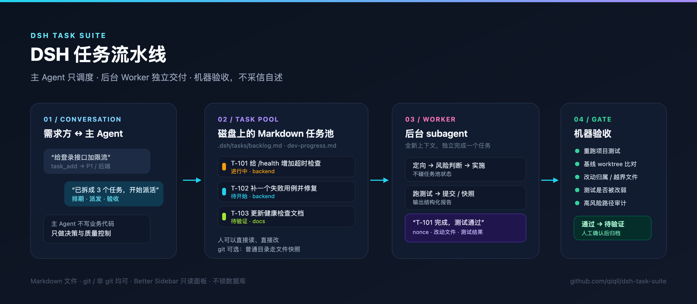
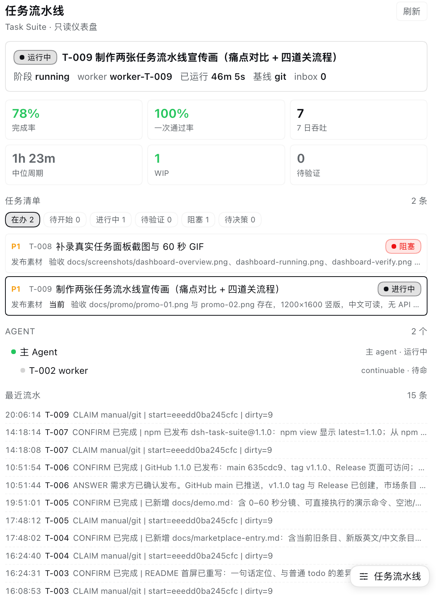

# DSH 任务流水线

[English](README.md) · **简体中文**

**把 Agent 从“助理”变成一支工程团队。**

> 主 Agent 只调度，后台 Agent 交付，机器验收后才算完成。

[](https://www.npmjs.com/package/dsh-task-suite)
[](LICENSE)
[](https://github.com/qiqll/dsh-task-suite)
[](https://awesome-dsh-plugin.com)

[**介绍页**](https://qiqll.github.io/dsh-task-suite/) · [npm](https://www.npmjs.com/package/dsh-task-suite) · [插件市场](https://awesome-dsh-plugin.com) · [Release 1.2.0](https://github.com/qiqll/dsh-task-suite/releases/tag/v1.2.0)

把 Claude 的 `task-*` 任务体系移植到 DeepSeek Harness：一份 Markdown 任务池、一套状态机、主会话调度、后台 worker、机器验收，以及一个只读的可视化面板。

它不是又一个 todo list。它解决的是「AI 说完成了，但没人验证」的问题。

**git 不是必需**：在 git 仓库里用 commit/worktree 验收；在普通目录自动降级为「文件快照模式」，用快照 + 文件清单完成基线比对、改动归属、测试改弱审计和回滚。

## 你现在的 Agent，更像一个随时待命的助理

- **同步**：它做一件，你看一件；想到下一个需求，也得等它空下来。
- **自评**：测试跑没跑、改动越没越界、测试有没有被改弱，全靠它自己说。
- **黑盒**：当前在做什么、什么卡住了、还剩多少，翻聊天记录才能猜。

不是模型不够聪明，是工作方式还停留在助理模式。真正稀缺的不是模型能力，是**管理能力**。

## 四换，一底线

| # | 从 | 到 | 解释 |
|---|---|---|---|
| 01 | 助理 | **团队** | 主 Agent 只做 Tech Lead：对话、拆解、调度、验收；具体工作交给独立上下文的 subagent。 |
| 02 | 对话 | **任务** | 每个需求都有 ID、优先级、验收标准、状态和依赖；按工程交付，不按聊天记录。 |
| 03 | 同步 | **异步** | 需求可以一次投递多条，进入任务池按序消化；你不必守着对话等它做完一件再提下一件。 |
| 04 | 黑盒 | **驾驶舱** | 任务、Agent、指标、事件流一屏可见；当前在做什么、什么卡住、什么待确认，一目了然。 |
| — | 自述 | **证据** | **底线**：worker 说“完成”不算完成；机器重跑测试、比对基线、审计测试改弱，人再做最后确认。 |

> “异步”指需求投递与交互异步：你可以连续投递，不必等一条结束；实际执行由流水线按序调度，默认同一时刻一个当前任务，避免并发写坏工作区。

## 和普通多 Agent / 任务列表的区别

| 维度 | 普通多 Agent / 简单 todo | DSH 任务流水线 |
|---|---|---|
| 工作单位 | 一段对话、一个 prompt | 有 ID、验收标准和状态的任务 |
| 谁干活 | 主 Agent 自己，或临时派发 | 独立上下文的 worker，主 Agent 只调度 |
| 完成标准 | worker 自己说完成 | 机器重跑测试 + 基线比对 + 人确认 |
| 交互方式 | 同步等待，一次一件 | 需求先入池，按流水线异步消化 |
| 过程可见 | 翻聊天记录 | 任务 / Agent / 指标 / 事件流 |
| 存储 | 依赖 git / 数据库 / SaaS | 磁盘上的 Markdown，git 可选 |

**多 Agent 是手段，不是产品。** 没有任务契约、验收门禁和可见性，多 Agent 只是把混乱并行化。

## 60 秒上手

```text
task_init
task_add items=[{title: "给登录接口加限流", module: "backend", priority: "P1", acceptance: "pytest tests/test_auth.py 通过"}]
task_loop action=start max=3 hours=2
task_loop action=tick        # 把返回的 worker_prompt 交给 subagent
# subagent 交付后：task_accept report="<报告块>" → task_confirm
```

然后从右侧栏 `+` 菜单或右下角 **任务流水线** 打开面板，看任务从「待开始」走到「待验证」。



> 上图是流程示意。下面是从真实会话截取的任务流水线面板：



> 面板包含任务池、Agent、指标和事件流；截图来自真实运行中的 T-009，已裁掉本地工作区路径。「待验证」态（验收标准、怎么验、默认通过日）见 [`dashboard-verify.png`](docs/screenshots/dashboard-verify.png)。

> 宣传画：[自评 vs 机器验收](docs/promo/promo-01.png) · [一条任务，四道关](docs/promo/promo-02.png)

## 安装

npm 安装（推荐）：

```sh
dsh plugin --profile desktop add dsh-task-suite
# Web profile 用 --profile web
```

也可以从 GitHub 源码安装：

```sh
dsh plugin --profile desktop add qiqll/dsh-task-suite
```

> `--profile` 必填：桌面版通常是 `desktop`，Web 版是 `web`；换成你实际使用的 profile 名。

桌面版也可以在 **设置 → 插件** 里搜索 `dsh-task-suite` 安装。首次安装后工具与三个 skill（`task-admin` / `task-loop` / `task-worker`）自动注册。

**首次安装后必须完整退出并重新打开 DSH。** Web 客户端插件表在进程启动时组合，只刷新页面不会加载新插件的客户端部分；Host 工具和任务池不受影响。之后进入任意会话即可使用。

本地开发时把本目录 `link:` 到 profile 的依赖里；Host 代码可禁用/启用插件行热重载，客户端 UI 改动仍需重启一次。

## Web 任务流水线

中文名：**DSH 任务流水线**。插件带一个只读面板，把任务池、当前 worker、门禁和运行指标集中到右侧栏。

打开方式（进入任意会话后）：

- 右下角浮动按钮 **任务流水线**（最直接）；
- 右侧栏顶部的 **+** 菜单 → **任务流水线**。

面板每 5 秒刷新，包含：

- **循环状态**：运行中 / 已停止 / 已叫停 / 空闲；
- **当前任务**：`T-xxx`、阶段、worker、已运行时间、快照/基线、门禁备注、inbox 数量；
- **指标**：完成率、一次通过率、7 日吞吐、中位周期（CLAIM → CONFIRM）、WIP、待验证；
- **任务清单**：按状态筛选，点开看备注/依赖/验收标准；
- **Agent**：主 agent 与当前子 agent 的活动状态；
- **最近流水**：运行日志里的 claim / done / confirm / reject / stop。

UI 依赖 [dsh-better-sidebar](https://github.com/omdsh-dev/DSH-better-sidebar)，但它是**软依赖**：没有安装时任务工具、API、任务池全部正常，只是没有这个面板；Web 也不会因此启动失败。

数据来自插件注册的只读接口 `GET /dsh-task-suite/state?sessionId=…&cwd=…`，不会修改任务池。

## 插件市场

本插件已收录进 [awesome-dsh-plugin](https://awesome-dsh-plugin.com)（分类 `workflow`，源码目录见 [GitHub](https://github.com/awesome-dsh-plugin/awesome-dsh-plugin)）；市场卡片、安装与更新由该目录和 npm 版本驱动。

详情页的 AppStore 风格截图来自仓库根目录的 [`screenshots.json`](screenshots.json)，共 4 张（面板总览、运行中、待验证、流程示意），文件在 [`docs/screenshots/`](docs/screenshots/)。改图只需改这个 JSON，不必重新发版。

## 快速开始

```text
task_init                                   # 建 .dsh/tasks/（git 仓库里顺带写 .gitignore）
task_add items=[{title, module, priority, deps, acceptance, note}]
task_status                                 # 全局视图 / 待决策 / 阻塞 / 流水
task_pick mode=manual task_id=T-001         # 手动单步，自己实施
task_accept report="<报告块>"               # 机器验收
task_confirm task_id=T-001 conclusion="..." # 需求方确认后归档
```

自动循环（推荐）：

```text
task_loop action=start max=10 hours=8
task_loop action=tick        # 返回 worker_prompt
# 把 worker_prompt 原样交给 subagent 工具；然后结束回合等完成通知
# 收到 worker 的最后一条消息后：
task_accept report="<整段报告块>"
# 通过 → 待验证；需求方确认 → task_confirm；不通过 → task_reject
task_loop action=tick        # 派下一个
```

停机：`task_loop action=stop reason="..."`；中途叫停：先 `interrupt_agent` 再
`task_loop action=halt`（保留提交，不回滚）。叫停后继续用 `action=resume`
（同一任务带断点重派），放回队列用 `action=requeue`。

## 状态与目录

```text
.dsh/tasks/
├── backlog.md          # 需求方入口：P0–P3 表、待决策、人工阻塞、ID 规则
├── dev-plan.md         # AI 维护：当前批次、进行中、技术前置
├── dev-progress.md     # 已完成归档（按月）
├── inbox/              # 需求方/调度方投递（task_*.json），merge 后移到 .merged/
└── auto/               # 运行时状态，整目录 gitignore
    ├── current.json    # 当前任务：nonce / startSha / 脏文件 / 阶段
    ├── session.json    # 循环会话：active / max / hours / done / noprog
    ├── run.log         # 运行流水
    ├── STOP            # 停机标记
    └── snapshots/      # 非 git 模式：开工快照 + manifest（确认后删）
        └── T-001-<nonce>/
            ├── manifest.json
            └── files/
```

git 仓库里 `task_init` 会把 `.dsh/tasks/` 加入 `.gitignore`；非 git 目录不创建 `.gitignore`。任务池是运行态，不进业务提交。
每个工作区独立一份池；默认不碰 Claude 的 `.claude/` 池。

状态机：

```text
待开始 → 进行中 → 待验证 → 已完成
             └→ 阻塞 / 待决策 → 待开始
             └→ 打回 → 进行中
```

同一时刻只允许一个「进行中」；P0 可中断（旧任务记断点）。

## 工具

| 工具 | 作用 | 关键参数 |
|---|---|---|
| `task_init` | 初始化池 + `.gitignore` | — |
| `task_add` | 录入 1..N 条，自动判重/ID/依赖/验收 | `items[]`, `source` |
| `task_status` | 全局视图与下一步建议 | — |
| `task_list` | 按状态/优先级/关键词筛选 | `status`, `priority`, `query` |
| `task_show` | 单任务完整简报 | `task_id` |
| `task_pick` | 认领任务；auto 返回 worker_prompt | `mode`(auto/manual), `task_id`, `interrupt` |
| `task_accept` | 机器验收 worker 报告 | `report`, `rollback` |
| `task_confirm` | 需求方确认 → 归档 | `task_id`, `conclusion`, `gate` |
| `task_reject` | 需求方打回 → 待开始 | `task_id`, `reason` |
| `task_answer` | 答复待决策/阻塞，回到待开始 | `task_id`, `answer` |
| `task_inbox` | 投递需求/决策（worker 在跑时用） | `type`, `text`, `title`, `ref` |
| `task_merge` | 立即合并 inbox | — |
| `task_loop` | 循环状态机 | `action`, `max`, `hours`, `reason` |
| `task_verify` | 只读重跑测试 + 基线比对 + 改弱审计 | `test_cmd`, `start_sha` |
| `task_audit` | 只读审计提交归属/越界/脏文件/改弱 | `start_sha`, `task_id` |

`task_loop` 的 action：`start` / `tick` / `stop` / `halt` / `resume` / `requeue` / `status`。

## Worker 报告契约

worker 最后一条消息只输出：

```text
=== TASK-AUTO REPORT ===
NONCE: <current.json 的口令>
RESULT: DONE | NEEDS_DECISION | BLOCKED | BASELINE_RED | FAILED | GATE_PENDING_REVIEW
TASK: T-001
START_SHA: <开工 SHA>
COMMITS: <sha...>
TEST_CMD: <[cd dir &&] 单条测试命令 路径...>
TEST_RESULT: 基线 x passed, y failed → 交付后 z passed, w failed；既有失败：...
TEST_CHANGES: 仅新增 / 无改动 / 有修改（说明）
GATE: <code-reviewer H×n M×n；跳过原因；...>
ACCEPTANCE: <对照验收标准>
ASSUMPTIONS: — / ...
DECISION: — / 问题 / 选项 / 推荐
BLOCKER: — / ...
DERIVED:
- [P2] 标题 | 涉及文件 ... | 来源 ...
BRIEF:
给需求方的 1–3 句人话说明
=== END REPORT ===
```

`task_accept` 会校验 nonce、任务归属、阶段、提交信息里的任务 ID、脏文件、
测试范围与基线失败集合、测试是否被改弱、高风险路径；通过后把任务落到
「待验证」并生成衍生任务，失败则按 RESULT 进入待决策 / 阻塞 / 自动失败计数。

`GATE_PENDING_REVIEW` 时验收暂停在 `review_pending`：调度员自己看 `start_sha..HEAD`，
通过就再调用 `task_accept` 并传 `review="pass: ..."`（同一报告即可），验收继续；
不通过就把发现发回 worker 修复并重交。

## 两种基线模式

`mode` 默认 `auto`：能拿到 git HEAD 就用 git 模式，否则自动用文件模式；也可以强制 `mode: file` / `mode: git`。

| | git 模式 | 文件模式（非 git 目录） |
|---|---|---|
| 开工基线 | `START_SHA` | `auto/snapshots/<T-NNN>-<nonce>/` 全量快照 + `manifest.json` |
| 改动归属 | commit message 含任务 ID | 快照与当前目录的文件差异（新增/修改/删除） |
| 基线测试 | `git worktree` 回到 START_SHA | 快照复制到临时目录，回放开工时代码 |
| 回滚 | `git reset --keep START_SHA` + ref | 从快照恢复文件，恢复前再备份当前树 |
| 提交要求 | 每个 commit 带任务 ID | 不 commit；`COMMITS: —` |
| 局限 | 要求有 HEAD | 无法区分「谁改的」；快照占磁盘；依赖目录/构建产物被排除 |

快照默认排除 `.git`、`node_modules`、`.venv`/`venv`、`__pycache__`、`dist`/`build`、`.dsh/tasks` 等。项目很大时用 `snapshotIgnore` 排除更多目录，或调大 `snapshotMaxBytes` / `snapshotMaxFiles`。任务确认/打回后快照会删除，并默认只保留最近 10 份。

文件模式的 `TEST_CMD`、测试改弱审计、nonce、遗留文件检查与 git 模式完全一致；只是「提交归属」换成「快照差异归属」。

## 验收与防作弊

- **nonce**：每次 claim 生成一次性口令，旧报告/重复通知直接丢弃。
- **提交归属**（git）：`git log START_SHA..HEAD` 里每个 commit 的 message 必须含任务 ID；出现别人的 commit → 停下，不自动处理。
- **改动归属**（文件）：与开工快照比对，新增/修改/删除都列出；报告 `CHANGES` 与实际不符会告警。
- **基线比对**：当前测试失败时，在 `git worktree` 的 START_SHA（git）或快照副本（文件）上重跑同一命令，只有「基线也失败」的用例才算既有失败；新失败 → 打回。
- **测试范围**：`TEST_CMD` 必须是单条命令，禁止 `; | & $( > <` 与
  `-k/--deselect/--ignore/--lf/--collect-only/--passWithNoTests`；
  改动/删除的测试文件必须落在命令路径参数覆盖范围内。
- **改弱审计**：删除用例、移走文件、skip/xfail、注释断言、断言净减少、
  测试配置 ignore 都会产生告警；DONE 带告警 → 转「待决策」。
- **高风险路径**：认证、支付、迁移、部署、CI、依赖清单等；命中时要求报告写
  `GATE` 与 `ASSUMPTIONS`，否则转人工 review。

## 配置

`cordis.patch.yml` 的 `config` 可覆盖：

| 键 | 默认 | 说明 |
|---|---|---|
| `stateDir` | `.dsh/tasks` | 相对项目根 |
| `testTimeoutSec` | `900` | 单次测试超时 |
| `defaultMaxTasks` | `10` | 循环最多交付数 |
| `defaultMaxHours` | `8` | 循环最长小时数 |
| `maxNoprog` | `3` | 连续无进展自动停机 |
| `maxDerivedPerParent` | `3` | 单任务衍生上限 |
| `maxDerivedDepth` | `2` | 衍生层级上限 |
| `mode` | `auto` | `auto` / `git` / `file`；强制文件模式可让 git 仓库也走快照 |
| `snapshotIgnore` | `[]` | 额外排除的相对路径或 `*` glob |
| `snapshotMaxBytes` | `536870912` | 单次快照体积上限（512MB） |
| `snapshotMaxFiles` | `20000` | 单次快照文件数上限 |
| `snapshotKeep` | `10` | 保留最近多少份快照 |

## 与 Claude 版的差异

- 状态目录是 `.dsh/tasks/`（DSH 独立运行态），不是 `.claude/`。
- 调度用 DSH 的 `subagent` 工具；没有内置心跳/cron，长循环可用
  `schedule_create` 定时提醒主会话 `tick`。
- 机器验收在原 `verify_tests.sh` / `check_test_weakening.sh` 的基础上重写为
  Node 实现，判定口径保持一致。
- 提供只读 Web 面板；`backlog.md` 仍是任务池的唯一事实来源。

## 开发自测

```bash
cd dsh-task-suite
node selftest.mjs       # 插件自测
npm run test:all        # 插件 + 面板 + CLI + 版本一致性
```

CI 在每次 push、PR 和 `v*` tag 上跑同一套四步，配置见 [`.github/workflows/version-check.yml`](.github/workflows/version-check.yml)。

自测覆盖两种模式：

- git：建池/录入/解析、认领、报告解析、DONE 验收与归档、FAIL_NEW 基线比对、测试改弱、inbox、待决策、循环启停、halt/resume/requeue；
- 非 git：快照认领、快照差异归属、DONE 验收、FAIL_NEW 基线、测试改弱、失败回滚。
