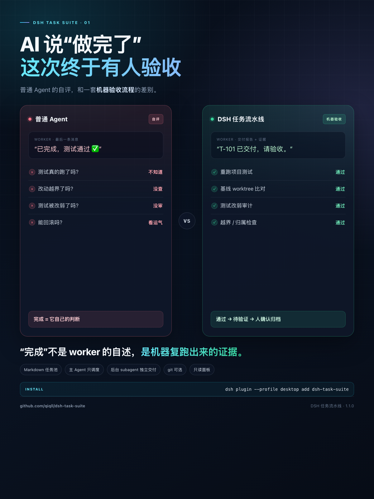
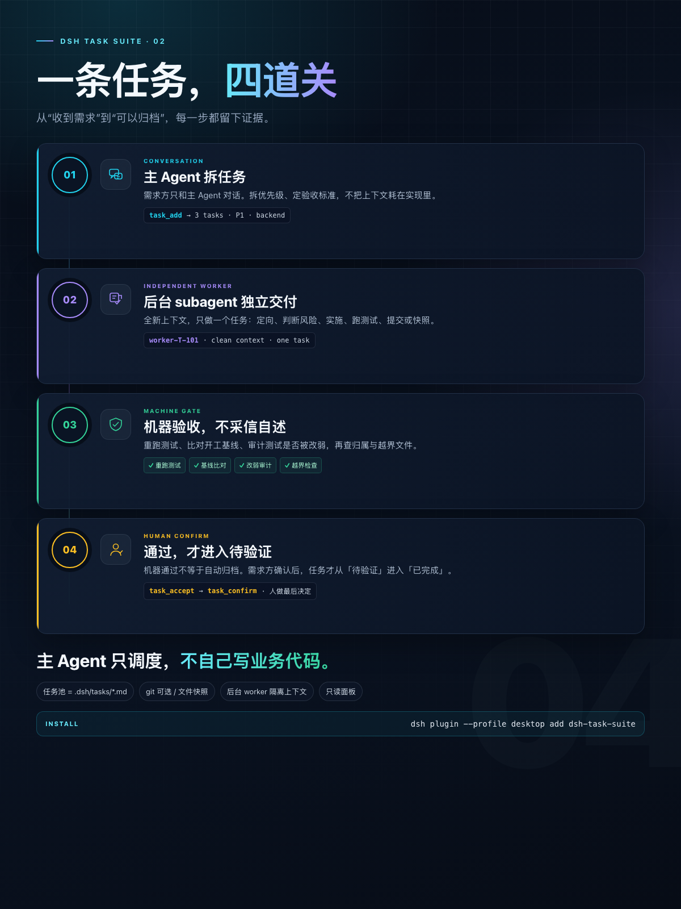

# 宣传画

两张竖版宣传画，用于首发、社交媒体和 README/文档引用。图片由同目录 HTML 源文件渲染，修改文案后可重新导出。

| 图 | 主题 | 尺寸 |
|---|---|---|
| [promo-01.png](promo-01.png) | 普通 Agent 自评 vs 机器验收 | 1200×1600 |
| [promo-02.png](promo-02.png) | 一条任务，四道关 | 1200×1600 |

高分辨率版本：`promo-01@2x.png`、`promo-02@2x.png`（2400×3200）。

## 预览

### 01 · 这次终于有人验收

### 02 · 一条任务，四道关

## 重新导出

源文件是纯 HTML/CSS，浏览器直接打开即可预览。导出 1200×1600 PNG：

1. 打开 `promo-01.html` 或 `promo-02.html`
2. 浏览器窗口设为 1200×1600，或使用无头 Chrome
3. 截图保存为对应 PNG

也可以使用仓库里的 `docs/promo/*.html` 作为设计源，修改文案后重新导出。
